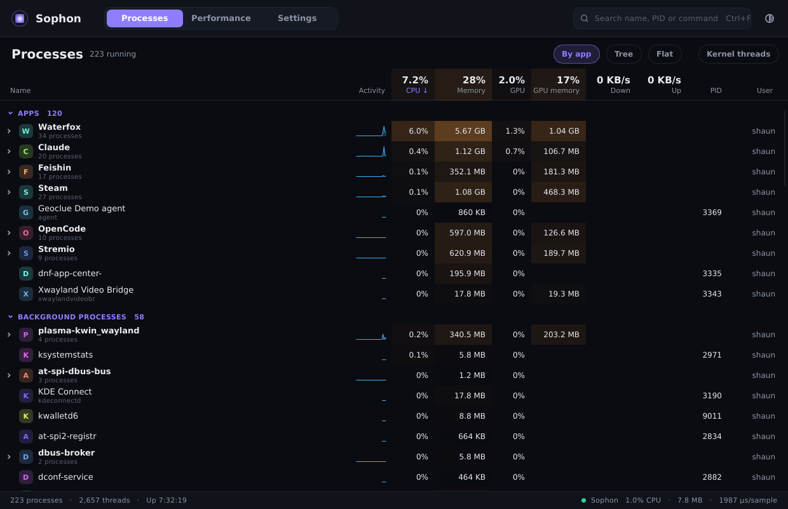

# Sophon

A Windows-style task manager for Linux that stays out of your games' way.

> *In* The Three-Body Problem, *a sophon is a single proton unfolded into a
> supercomputer that silently watches everything. The lightest possible thing
> that sees every process.*



See **[SPEC.md](SPEC.md)** for a complete from-scratch build specification
(architecture, data sources, algorithms, exact procfs/sysfs formats).

## Features

**Processes**
- Collapsible Apps / Background / System sections, with processes grouped by the app that launched them
  (via the systemd scope each app runs in), or a flat list
- Friendly names from `.desktop` files and a table of well-known system processes
- CPU, private memory, GPU, GPU memory and network down/up per process, with heat-mapped cells
  and per-row sparklines (network counts TCP; UDP needs admin features)
- Hold the pointer on any column header for an explanation of the number
- Details pane: parent, clickable children, executable, command line, unit, status
- End task, end process tree, force kill, open file location (Dolphin/Nautilus highlight the file)
- Search by name, PID or command line (`Ctrl+F`), `Del` to end the selection (`Shift+Del` to force kill)

**Performance**
- **Rewind**: 10 minutes of history on every graph (1 / 5 / 10 min views). Hover anywhere for a
  crosshair across all graphs with exact values and clock time; drag to zoom into a moment (graphs
  pause, "Back to live" returns); double-click resets. Spikes on the CPU and GPU graphs get markers
  naming the apps responsible; click one to jump to that process
- CPU: utilisation, per-thread grid, clocks, temperature, package power
- Memory: usage, composition, swap, zram compression ratio, commit
- GPU (AMD today): utilisation, per-engine load (3D, compute, copy, video decode/encode), VRAM, temperatures, power, fan, clocks
- Disks: active time, response time, read/write throughput, temperature
- **Space map**: a treemap of what's filling each drive. Scan on demand (parallel, at idle CPU and I/O
  priority). Click to select, Shift+click to select several, double-click to enter a folder,
  breadcrumbs to go back, hover to highlight, hold for the full path. Right-click (or Delete) to open,
  show in the file manager, or move the whole selection to the Trash (with confirmation)
- Network: receive/send throughput per interface

**Settings** (third tab, live preview, search, per-setting reset)
- General: startup, close-to-tray behaviour, confirmations, and **admin access**
- Appearance: theme, accent + per-metric colours, scale, density, corner roundness, graph style, animations
- Resource use: update speed (0.5–5 s / paused), tray update rate, CPU/GPU renderer
- Processes tab: drag/hide/resize columns, grouping (app/tree/flat), name style, units, CPU % mode, row actions
- Performance tab: reorder/hide device tiles, CPU detail (total/thread/core), **history length (10 min / 1 h / 24 h)**, spike sensitivity, °C/°F
- Space map: default drive, scan priority, hidden files, excluded folders, **colour by folder / file type / age**, remember scans
- Tray: what the hover summary shows
- Saved as plain text at `~/.config/sophon/settings.conf`

**Admin features** (optional, opt-in)
- One password prompt (pkexec) starts a small privileged helper; Sophon itself never runs as root
- Lets you end/kill any process (system or other users'), and count **UDP** network per app (games, voice) via a kernel eBPF counter
- The helper only accepts a fixed request list, runs no shell, touches no files, and exits when Sophon closes

**Stays out of the way**
- Closing the window sends Sophon to the tray (like Steam): no taskbar entry, near-zero cost
- Tray icon: hover for a live CPU / RAM / GPU summary, click to open the window again;
  quit from the tray menu or with `Ctrl+Q`

Light, dark and follow-system themes. `Ctrl+Tab` cycles the three tabs (Processes, Performance, Settings).

## Resource use

Measured on a Ryzen 7 5800X / RX 6950 XT, ~500 processes, with a game running:

| | |
|---|---|
| Memory (PSS) | **~25 MB** |
| CPU, window visible, processes tab | ~1.2% of one core (0.3% sampling + ~0.9% drawing) |
| CPU, closed to the tray | **~0.13% of one core** (~19 MB) |
| Sampler cost per tick | ~2.6 ms of CPU time (one shared fd walk feeds GPU + network) |
| Space map scan of `/home` (1.4M files, 487 GB) | ~2.3 s warm cache, ~11 s cold; +12 MB while results are kept |

How:
- Everything is read straight from `/proc` and `/sys` with `openat` into reused buffers, and parsed by hand.
- Anything fixed for a process's lifetime (exe, command line, cgroup, name) is read once.
- Idle processes, idle GPU clients and kernel threads are polled less often, with exact CPU maths across the gaps.
- GPU fd discovery is spread over time instead of walking every fd of every process at once.
- The process table isn't sampled at all unless the Processes tab is showing.
- When the window is hidden or minimized, sampling drops to every 5 s. On X11 this uses occlusion events; on Wayland it notices that the compositor has stopped presenting frames.
- Rendering uses Slint's CPU renderer with partial repaints (lighter than a GPU context for a 1 Hz UI).

## Build

Needs Rust 1.88+. No `-devel` packages required: fontconfig, Wayland and X11 are loaded at runtime.

```bash
cargo build --release
./target/release/sophon
# Optional: add Sophon to your app launcher so the taskbar shows its name and icon
./target/release/sophon --install      # --uninstall removes it
```

Dev tools:

```bash
# Sampler cost and a dump of everything it reads
cargo run --release -p sophon-core --example bench

# Time a space-map scan
cargo run --release -p sophon-core --example space -- /home

# Render every view (dark + light) to PNGs, then exit
SOPHON_SNAPSHOT=/tmp/shots ./target/release/sophon

# Log visibility changes, frames presented and per-tick UI cost
SOPHON_DEBUG=1 ./target/release/sophon

# Compare renderers
SLINT_BACKEND=winit-femtovg ./target/release/sophon
```

## Layout

```
crates/
  sophon-core/            UI-free sampling engine (no Slint; reusable by a future TUI)
    sys.rs                openat/readlinkat/readdir wrappers, zero-alloc stack paths
    parse.rs              byte-level procfs/sysfs parsers (no regex, no alloc)
    history.rs            fixed-capacity ring buffers for time series
    process.rs            process table, adaptive per-process polling
    apps.rs               .desktop index, systemd-unit -> app mapping, pretty names
    cpu.rs mem.rs disk.rs net.rs   per-subsystem collectors
    fdwalk.rs             one shared, rolling walk over process fds (GPU + sockets)
    gpu/                  GpuDevice trait, amdgpu backend, DRM fdinfo per-process scanner
    netproc.rs            per-process TCP throughput (sock_diag); eBPF cookies when admin is on
    space.rs              parallel treemap scanner, mount discovery, scan cache
    sampler.rs            ties collectors together; one Snapshot per tick
  sophon-app/             Slint GUI (depends on sophon-core)
    build.rs             compiles ui/app.slint
    ui/*.slint           theme, widgets, Processes/Performance/Settings/Space views
    src/main.rs          window, tray, sampler thread, CLI (--helper/--install/--tray)
    src/ui.rs            Snapshot -> Slint models; Processes + Performance + Rewind
    src/space_ui.rs      squarified treemap layout, scan lifecycle, trash
    src/settings.rs      config file + defaults
    src/settings_page.rs the Settings tab (rows built from Settings)
    src/graph.rs src/fmt.rs   graph paths and number formatting
    src/icon.rs src/png.rs    generated app icon, PNG writer
    src/admin.rs         talks to the privileged helper
    src/helper.rs        the privileged helper (sophon --helper, via pkexec)
    src/ebpf.rs          per-socket byte counters (cgroup_skb eBPF programs)
    src/actions.rs       kill/term, process tree, open file location
    src/snapshot.rs      dev-only: render every view to PNG (SOPHON_SNAPSHOT)
```

## Roadmap

- [ ] Steam/Proton game detection: collapse Wine helpers into one row named after the game, with cover art
- [ ] App icons from the icon theme
- [ ] Pause/resume an app (`cgroup.freeze`), end an app atomically (`cgroup.kill`)
- [ ] Process priority / CPU affinity controls (via the admin helper)
- [ ] Per-process disk I/O
- [ ] NVIDIA (NVML via dlopen) and Intel GPU backends
- [ ] Keyboard navigation for the tree view and space map
- [ ] Startup apps and services tabs
- [ ] `--tui` terminal mode on top of `sophon-core`
- [ ] Packaging: COPR RPM (Flatpak can't see host processes)
